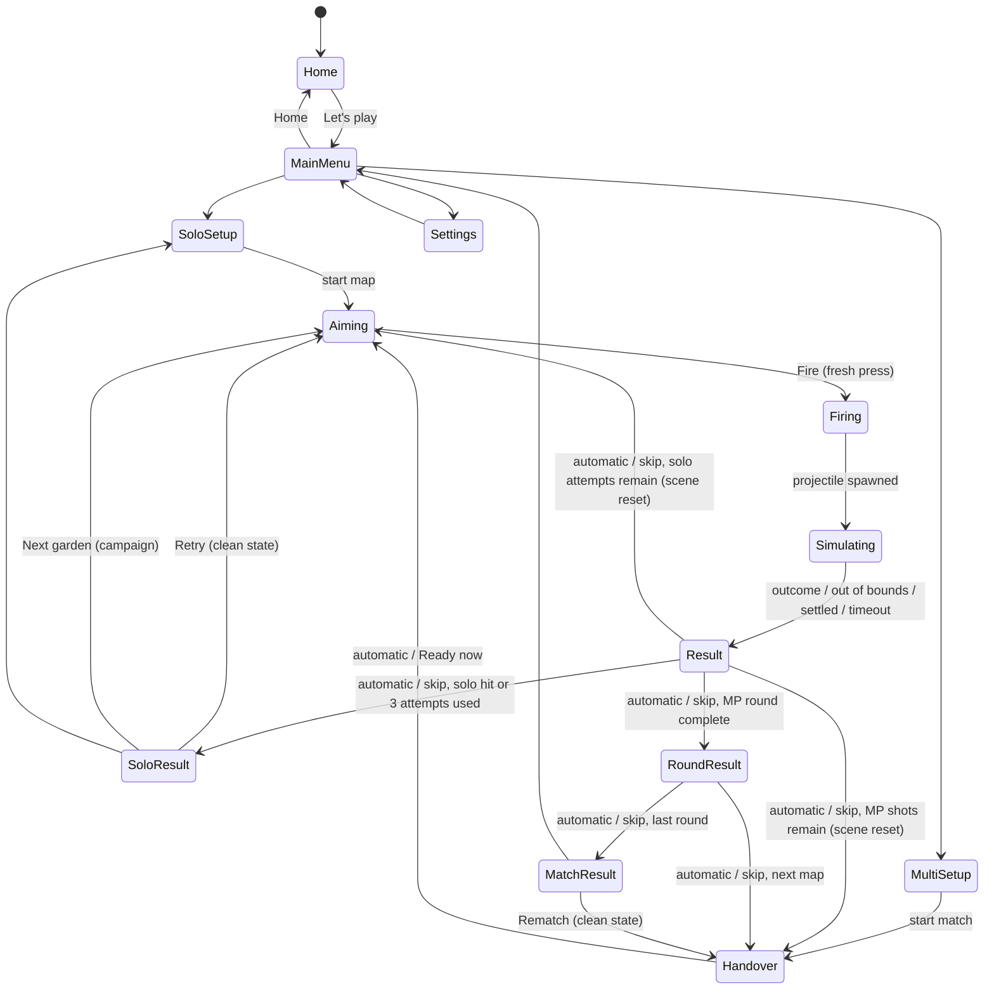

# Hit Jonh — Implementation Specification

**Status:** Authoritative implementation specification, v0.2 (4 October 2026)
**Source:** Derived from `hit-jonh-game-design.md` (design brief v0.1). Where they disagree, this file wins; record any change in `docs/progress.md`.
**Spelling:** The character and game are **Jonh** / **Hit Jonh**. Never "John".

### How to read the labels

| Label | Meaning |
| --- | --- |
| **[DECIDED]** | Fixed by the design brief or by an explicit request from the project owner. |
| **[PROPOSED]** | A default chosen to unblock implementation. **Not approved by the owner.** Change freely after playtesting. |
| **[ASSUMPTION]** | Something believed true that must be verified during the named milestone. |
| **[TUNE]** | A numeric value expected to change during playtesting. Lives in `src/config/tuning.ts` or level data. |
| **[OPEN]** | Unresolved. Do not silently decide it; pick a reversible default and log it. |

---

## 1. Product concept

A humorous 2D browser game. Players adjust a cannon's **angle** and **power** to hit Jonh, an ordinary man trying to enjoy his afternoon. Flight follows consistent, believable gravity; the comedy comes from Jonh's calm, disproportionate reactions and the physical consequences. **[DECIDED]**

**Player fantasy:** make a precise shot, watch an outrageous consequence, prove you can do it in fewer attempts than your friends.

## 2. Design pillars [DECIDED]

| Pillar | Consequence for implementation |
| --- | --- |
| Learnable aiming | Identical inputs + identical scene ⇒ identical flight and outcome (within one build/browser). |
| Useful misses | Show the previous trail and landing point; keep the last settings. |
| Physical comedy | Humour lives in reactions, props, sound — never in altering the shot. |
| Fair local competition | Same launch position, same shot count, scene reset before every competitive shot. |
| Quick replay | Retry/rematch in one action; result screens are skippable. |
| Manageable first release | One projectile, three maps; every feature must improve the angle/power/hit loop. |

## 3. Core loop and controls

**Owner-requested usability pass (4 October 2026) [DECIDED]:** Canvas drag aiming, automatic progression after shots, clearly alternating multiplayer turns, obstacles on every map, comic hit/FAAH sounds, a home screen above the mode menu, an in-game Home action, and multiplayer map selection. These replace conflicting earlier prototype defaults below. Deferred features remain outside this pass.

### 3.1 Loop [DECIDED]

1. Read the scene → 2. Aim (angle, power) → 3. Fire (inputs frozen) → 4. Watch → 5. Resolve (classify, feedback, reaction) → 6. Continue (retry, hand over, next map).

The player must be able to tell **short**, **over**, and **obstacle hit** apart. Shot results advance automatically after a short reaction window; a Next now action can skip that wait. Terminal solo/match results stay visible for retry/rematch.

**First-garden coach [DECIDED request 2026-11-25; rules and wording PROPOSED]** (`rules/coach.ts`, `COACH` in tuning). Until a player's first hit ever (`progress.totalHits` is 0):
- On the first campaign garden, before the first shot, a ghost glove loops the gesture: press on the cannon, drag up and away. It disappears as soon as the aim changes or a shot is fired, and holds still under reduced motion.
- After each solo miss, the aiming caption becomes a tip that names one fix and stays up while re-aiming: "Short. Add power." (or "Aim nearer 45°" near full power), "Too far. Take off some power.", "Over his head. Less power.", "Blocked. Aim higher." A ball that lands short and rolls into an obstacle counts as short.
- A brand-new player's **Play** starts the first garden in one tap; **All modes** opens mode selection.

### 3.2 Controls

| Action | Pointer / touch | Keyboard [PROPOSED] |
| --- | --- | --- |
| Angle | Drag up/down anywhere on canvas, or angle slider [DECIDED] | ← / → (1° per press) |
| Power | Power slider | ↓ / ↑ (1 % per press) |
| Fire | Fire button | Space |
| Continue / hand over | Automatic after a short window; button skips wait | Enter skips the shot result |
| Pause | Pause button | Escape |

- Display angle in whole degrees and power as an integer percentage. **[DECIDED]**
- Angle range **5°–85°** above horizontal **[PROPOSED][TUNE]**. Power **0–100 %**. Every map must be solvable inside these ranges.
- Controls are **HTML elements outside the canvas** (native slider accessibility, touch, focus handling) **[PROPOSED]**.
- **Accessibility pass [DECIDED request 2026-11-25; details PROPOSED]:**
  - **Remappable keys.** Settings → Keys rebinds Fire, Skip/next, angle, power, Aim again/retry and Sound (`input/keyBindings.ts`, saved in settings). Escape (pause/back) and Tab (focus) are fixed. Binding a key that is already used swaps the two actions. The FIRE button, the Next pill and the result card's retry hint show the bound keys.
  - **Screen readers.** A polite live region (`ui/announcer.ts`) reads out moments that only show on screen: the chapter card, each handover (banner, stakes, taunt), round and match results, and the solo result (stars, ribbons, unlocks, feats, Jonh's line). The HUD caption was already live.
  - **Touch targets.** Every control is at least 44 CSS px on phones (audited at 390×844 and 844×390).
  - **Colour vision.** Player colours stay distinguishable with normal vision. Under simulated deuteranopia, tomato/leaf and sky/grape come close (ΔE76 about 15 and 11). Colour therefore never stands alone: cannons pair it with patterns, panels and cards show names, and trails have ink outlines (`tests/colorVision.test.ts`).
- **Accidental-action rules [DECIDED]:**
  - Fire is accepted only in the `aiming` state.
  - Fire requires a fresh press: ignore `KeyboardEvent.repeat`, and ignore Space until it has been released at least once after entering `aiming`.
  - Gameplay shortcuts are ignored while a text input/select has focus.
- Aiming aids **[DECIDED]**: barrel shows true angle; short initial-direction guide at the muzzle; last trail + landing marker. **No full trajectory preview** in normal play (the short launch preview of §10.3 is bent by the level's constant wind, §8.7).

## 4. First-release scope

### 4.1 Included [DECIDED]

- One cannonball type.
- Three maps: Jonh's Backyard (flat), The Fence Dispute (obstacle), Rooftop Lunch (elevated target).
- **[DECIDED by owner 2026-10-10]** Eight maps, the same in every mode (solo, Daily Bonk, hot-seat, online): the original three plus Rubber Yard, retuned to be clearly harder, and four mechanic maps — a ricochet-only bank shot, a trampoline-only map, a low-gravity Moon map and a very zoomed-out map. See §11.
- **[DECIDED request by owner 2026-11-24]** "New obstacle types and map mechanics (moving platforms, breakables, portals or wind), all in SI level data with reference solutions that pass the existing tests." Implemented: **breakable props** and **one-way portals** (§8.6), each showcased by one new map (The Greenhouse, The Magic Act; §11), so there are now ten maps in every mode. Moving platforms and wind were not chosen and stay deferred (§4.2). Rules and values are [PROPOSED][TUNE].
- **[DECIDED by owner 2026-11-25]** "A wind garden. A third mechanic: a per-level constant wind with a windsock and streaks, deterministic, with the launch preview bending to match." Implemented as a constant horizontal wind on the ball (§8.7), showcased by one new map, Windy Washday (§11), so there are now eleven maps in every mode. Rules and values are [PROPOSED][TUNE].
- **[DECIDED by owner 2026-11-25]** "A walking-Jonh garden. A predictable route timed from Fire (a timing challenge)." Implemented as **The Afternoon Stroll** (§8.8, §11), so there are now twelve maps (with Windy Washday) in every mode. The exception to "his collider does not move during a shot" (§10) covers this one garden only; every other map behaves exactly as before. Name, layout, route and rules are [PROPOSED][TUNE].
- Solo challenges: three attempts per map.
- Local multiplayer, 2–4 players, one device, turn-based.
- Saved aiming settings, previous-shot trails, scoring, quick rematch.
- Cartoon presentation, slapstick reactions (stationary Jonh: idle + hit reactions).
- Essential sound effects, mute, reduced-motion setting.

### 4.2 Deferred (not permanent exclusions)

Accounts, public matchmaking and leaderboards (online play by room code is in scope since 2026-10-08, see §6.1); simultaneous firing; AI opponents; drag and weather, and any wind that changes (gusts, per-shot or random wind) — a **constant per-level wind** is in scope since 2026-11-25, §8.7; moving platforms; extra ammo; articulated ragdolls; destructible terrain and chain reactions (single breakable props that reset every attempt are in scope since 2026-11-24, §8.6); Jonh moving during shots (except the walking-Jonh garden, owner-approved 2026-11-25, §8.8); upgrades/shops/economy; level editor; global leaderboards; ~~unlimited practice mode (**optional** — only if cheap, and must never overwrite challenge results)~~ (built 2026-11-25 on cleared gardens, see §5).

## 5. Solo rules

- ~~Choose any map (all unlocked).~~ Three attempts. **[DECIDED]**
- **Campaign [DECIDED by owner 2026-11-24: a campaign through the maps with star ratings and unlockable maps; order and unlock rule PROPOSED]:**
  - Solo is a campaign through every map in a fixed order: Backyard, Fence, Rooftop, Greenhouse, Rubber Yard, Bank Shot, Magic Act, Afternoon Stroll [PROPOSED 2026-11-25], Lunar Picnic, Bounce House, Valley (`rules/campaign.ts` `CAMPAIGN_ORDER`; maps not listed join at the end).
  - A garden unlocks when the previous one is cleared (any star). A garden that already has a saved record stays open, so older saves lose nothing.
  - Each garden shows its stars (by shots used, below) and a separate **trick badge**, earned once a ricochet body hit lands there. The map screen and the win screen show the campaign star total.
  - A win offers **Next garden** (N, focused) as well as Retry (R) and Map select. The title offers **Continue** to the first uncleared garden (then the first one short of three stars).
  - Hot-seat, online and Daily Bonk keep every map available.
- A valid **body hit** ends the challenge immediately as a success. **[DECIDED]**
- Hat-only hits do **not** count as success in solo **[PROPOSED]**.
- After three non-successful attempts: short failure result with immediate Retry.
- Rating **[PROPOSED]**: ★★★ hit on shot 1, ★★ on shot 2, ★ on shot 3. A qualifying ricochet body hit adds a separate "style" marker; it does not change stars.
- Best result per map stored locally (fewest shots; style marker kept if ever earned) **[PROPOSED]**.
- Scene reset before every attempt (see §7); settings and last trail persist across attempts.
- **Practice [DECIDED request 2026-11-25; rules PROPOSED]:** on any garden already cleared, unlimited shots that never end in a result. Nothing is saved: no stars, bests, trick badges, aim, streak, hit totals or unlocks. Entered from the garden list's Challenge/Practice switch or the Practice (P) button on a cleared garden's result card. The HUD shows "Practice · {garden}" and hits so far; pausing offers End practice, which returns to the practice list.

## 6. Local multiplayer rules

- 2–4 players; each has a name (default "Player N", typing never required), a cannon colour **and** pattern (not colour alone), personal angle/power. **[DECIDED]**
- All players fire from the **same launch position**; inactive cannons are drawn as decorative slots outside the playfield. **[DECIDED]**
- **Map selection [DECIDED]:** Available in multiplayer setup. **Format [DECIDED by owner 2026-10-10]:** tick any set of maps; all maps may be deselected in setup, but Start match is disabled and gray until at least one is selected [DECIDED by owner 2026-10-10]. Selected maps are played one per round in the shared map order. Preset chips **[PROPOSED]**: Classic tour (Backyard, Fence, Rooftop, Rubber Yard — the default), Trick shots (the mechanic maps, including The Greenhouse and The Magic Act since 2026-11-24 and The Afternoon Stroll since 2026-11-25), Every map. The online host uses the same picker; guests see the chosen set read-only. Each player gets **3 shots per round**, fired in rotating order (A, B, C, A, B, C, …), not consecutively [DECIDED]. Rematch retains the chosen maps.
- Starting player rotates between rounds: round *r* (0-based) starts with player index `r mod N`. **[DECIDED principle, PROPOSED formula]**
- A round always completes every player's shots, even after an early hit. **[DECIDED]**
- **Target cycles (owner-approved 4 October 2026) [DECIDED]:** Each round has three shot cycles, one shot per player per cycle. Jonh stays at the same position for every player in that cycle and throughout each shot's result/reaction. At handover into the next cycle he relocates to a different authored position. Each map's three positions are shuffled independently without replacement at match creation and rematch; the schedule is held in match memory, never in save data. Resetting aim and pausing do not change it. Solo remains unchanged.
- Multiplayer target centres are Backyard **15, 18, 21 m**, Fence **14, 17, 20 m**, Rooftop **16, 18.5, 21 m**. Horizontal body/hat offsets and tested reference shots live in level data. Height, dimensions, obstacles, scoring and physics stay unchanged. Saved aim and personal trails persist as adjustment aids; cycle status explains that Jonh has moved. **[DECIDED]**
- A brief handover screen names the next player, then automatically opens aiming; Ready now skips the wait. Their saved settings and last trail load automatically. **[DECIDED by owner 2026-10-10]** A persistent vertical player panel beside the arena shows the roster, cannon colours/patterns, total points and the current turn/shot phase in both local and online matches. Online also identifies your seat and shows presence (Online, Away, Left, or Connection unknown during reconnection). On narrow portrait screens the panel sits below the arena and HUD. It replaces the score chips over the playfield.
- Players **can** learn from each other's shots; this is intended. **[DECIDED]**
- **Party callouts [PROPOSED 2026-11-24; presentation only, scoring and the winner rule unchanged]** (`rules/matchStakes.ts`):
  - Each handover shows what the shot means ("Trailing Bo by 75", "Leading by 25", "All square"), and the same line appears in the HUD while aiming.
  - Banners mark "Final round" (first shot of the last round, multi-round matches), "Your last shot", and "Last shot of the match".
  - The match's final shot spells out exactly what wins or ties under the §7.1 winner rule ("Only a trick shot wins it! A hit ties."). It plays a drumroll and gets a longer card.
  - Whoever just scored taunts the next player on the handover card (hot-seat and online).
  - The round summary before the final round says so.
  - **Winning-shot replay:** when a match ends, the winner's best hit plays again before the scores. "Best" is their latest trick shot, else their latest hit; ties use any winner's.
    - It plays in its own garden at the spot where it happened, with their cannon colours, under a "Winning shot · {name}" letterbox.
    - It is the recorded Matter flight with the full impact, and it is skippable.
    - It is off under reduced motion, and skipped if a re-simulation no longer reaches Jonh (cross-browser drift online).
- Which previous trails are visible: active player's last trail in their colour **[PROPOSED]**; showing others' trails faintly is **[OPEN]**.

## 6.1 Online multiplayer [DECIDED by owner 2026-10-08]

Design: `docs/superpowers/specs/2026-10-08-online-multiplayer-design.md`. Summary:

- **Rooms by code.** One player creates a room and gets a 5-character code (shareable as `?room=CODE`); 2–4 friends join. No accounts, no matchmaking. Seat 0 is host in the lobby (maps, Start).
- **Live and turn-based.** Same rules as §6/§7. Each shot is sent when fired (angle/power) and again when it lands (outcome). Every client re-simulates locally; the **shooter's outcome is official** for score and label. Cross-browser divergence only affects the animation.
- **Trust.** The shooter's client is trusted. The server checks turn order, aim ranges, duplicates and map-impossible outcomes, and does not re-simulate physics.
- **Timers run on the server.** Online-only turn limit of 120 s (countdown from 90 s). Missing player skipped after 90 s without a heartbeat (warning from 60 s). Unreported shot resolved after 40 s with a spectator's outcome or a miss. If everyone is disconnected at once, nothing is skipped. Values are [PROPOSED][TUNE] in `ONLINE` (`src/config/tuning.ts`), except the 120 s limit [DECIDED].
- **Rematch.** Any active player may press Rematch. It starts when everyone is ready, or after a 30 s window with the ready players (at least 2). Others see "You weren't included".
- **Identity.** One player per browser tab (token in sessionStorage); a reload keeps the seat. The name/colour profile is saved in the `online` field of the `hitJonh.v1` save. The hot-seat roster is untouched.
- **Emotes [DECIDED request by owner 2026-11-25; the set, limits and presentation are PROPOSED]** (`rules/onlineEmotes.ts`, `convex/emotes.ts`). Quick reactions everyone in the room sees, matching the hot-seat taunts. This is not chat: the set is fixed and an emote travels as an id, never as free text, so there is nothing to moderate.
  - **Set [PROPOSED]:** Beat that!, Unlucky!, Nice shot!, Oof., Poor Jonh., Rematch?
  - **Allowed** in the lobby, during a match and on the result screen. An emote never affects turns, timers, check-ins, scoring or the room's 24 h cleanup clock.
  - **Rate limit [PROPOSED][TUNE]**, per seat and enforced by the server: a burst of 3, then one more every 2 s (`ONLINE.emoteBurst`, `emoteRefillSeconds`). The client applies the same limit first, so spamming shows "Easy there!" instead of calling the server.
  - **Delivery:** a seat's latest emote lives in its own `emotes` row, so it never contends with turn, shot or check-in writes, and has its own `getEmotes` subscription (like presence). A client shows only emotes newer than the first list it received, so nothing replays after a reload. One delivered more than 10 s after it was sent is dropped.
  - **Presentation [PROPOSED][TUNE]:** the sender's bubble sits in their player-panel row for 4 s (and in a small stack beside the Emote button wherever the panel is not on screen: lobby, result, overlays, portrait phones), with a soft sound for other players' emotes. Your own bubble appears the moment you send it and is taken back if the server refuses it.
  - **Controls:** an Emote button (bottom-left), `E` to open, `1`–`6` to pick, Esc to close. Pointer presses and picking never leave a button focused, so Space still fires and Enter still skips.
  - **Deploy:** needs a Convex redeploy (new table and two functions); see `convex/README.md`.
- **Out of scope.** Accounts, matchmaking, chat (free-text messages; canned emotes are in scope since 2026-11-25), spectators, live aim streaming, server physics, async play, deployment, kicking.
- **Known limitation.** After a reload, previous-shot trails are empty until each player fires again.

## 7. Scoring and scene reset

### 7.1 Shot outcomes (recorded **once** per shot)

| Outcome | Definition | MP points [PROPOSED] |
| --- | --- | ---: |
| Ricochet body hit | Body hit after the projectile contacted a surface flagged `ricochet: true` in level data during this shot | 125 total |
| Body hit | Projectile (or, later, a prop it owns) contacts Jonh's body collider | 100 |
| Hat-only hit | Contacted the hat collider, never the body | 20 |
| Miss | None of the above | 0 |

- Award only the **highest** applicable outcome. Hat-then-body ⇒ body result.
- **Ground is never ricochet-eligible.** Which surfaces are eligible is per-map data **[OPEN]** (initial proposal: fence faces and the building wall).
- **[PROPOSED 2026-11-24]** Smashing through a breakable prop and going through a portal are never ricochet contacts (nor obstacle contacts). A breakable struck too softly to break is an ordinary obstacle and uses its own `ricochet` flag. On the new maps no surface is ricochet-eligible (glass, greenhouse frame and brick, tent velvet, stage), so both score plain body hits.
- **[PROPOSED 2026-11-25]** Walking Jonh (§8.8): classification and points are unchanged. A ball he walks into (even one lying still on his path) touches him, so it counts like any other contact. The weak/strong threshold (10 m/s, §10.1) uses **the ball's own incoming speed**, not the speed relative to Jonh: his walk is at most 2 m/s, the replay and the scoring stay identical to every other map, and a ball he bumps into is a weak hit.
- No near-miss points. **[DECIDED]**
- Idempotency: the first body contact finalises scoring; later collision callbacks cannot change or repeat it. **[DECIDED]**
- Winner: highest total. Tie-break: more body hits; still tied ⇒ shared win. **[PROPOSED]**
- **Sudden death (hot-seat) [DECIDED request 2026-11-25; rules PROPOSED]** (`MatchOptions.suddenDeath` in `rules/multiplayerMatch.ts`). A hot-seat match still tied after the tie-break goes to a shoot-out on the last garden, with Jonh at a fresh spot. Each tied player takes one shot, and the best outcome wins: trick > hit > hat > miss. Players still level go again from a new spot, with the order rotated. After 3 shoot-out rounds (`MULTIPLAYER.suddenDeathRounds`) the win is shared. Shoot-out shots never change totals or hits. The handover cards say what each shot needs ("Only a trick shot ties it!"), and the result says "Won in sudden death!". Online matches keep the shared win: the server rules are unchanged.

### 7.2 Scene reset [DECIDED principle]

Before **every** attempt (solo and MP): remove live projectiles, restore Jonh, hat, and every prop/obstacle to level-data spawn state, clear pending timers and score events from the previous shot. This includes making every smashed breakable whole again and re-arming every portal (§8.6). Preserve: each player's angle/power, each player's last trail and landing marker, scores. The map is unchanged within a round.

**Multiplayer exception [DECIDED]:** Jonh and his nearby decorative scenery reset to the active cycle's authored position, rather than the solo spawn. The effective level is shared by rendering, Matter colliders and swept collision detection; original level data is never mutated. Position changes happen only in handover after all players complete the preceding cycle.

**Restart / rematch:** clears all live bodies, timers, pending events, and scores; keeps player names, colours and aim settings **[PROPOSED]**.

### 7.3 Persistence [PROPOSED]

`localStorage` key `hitJonh.v1` (versioned JSON; ignore and replace on parse failure): solo best per map, last solo aim per map, settings (mute, volume, reduced motion), last MP player setup.

## 8. Physics requirements

### 8.1 Units and coordinates

- Simulation maths: **metres, seconds, kilograms; +y up**. Gravity **g = 9.81 m/s²** downward. **[DECIDED]**
- Phaser/Matter world: logical pixels, **+y down**, fixed logical viewport **1280 × 560 px** **[PROPOSED][TUNE]**. The appearance improvement pass crops unused upper sky; metres, gravity, geometry, launch speed and horizontal bounds are unchanged. Flights above the viewport remain simulated and use an off-screen marker.
- Scale: **50 px per metre** **[PROPOSED][TUNE]** ⇒ visible viewport is **25.6 m × 11.2 m**. Level bounds retain 25.6 m × 14.4 m; leaving the top is allowed.
- The canvas is scaled to the container (`Phaser.Scale.FIT`). Screen size **never** affects physics. Verified at setup: logical size stays 1280×720 and Matter gravity unchanged when the viewport is 500 px wide.
- All conversions live in `src/sim/units.ts`; no inline magic conversion factors elsewhere.

**Matter.js 0.20 unit facts (verified from Phaser 4.2.1 bundled source):**
- Matter integrates with position Verlet. Gravitational acceleration in **px/ms²** = `gravity.y × gravity.scale` (default scale 0.001). Hence `gravity.y = g · ppm / 10⁶ / scale` = **0.4905** for 9.81 m/s² at 50 px/m (unit-tested).
- `Body.setVelocity` takes **px per base step** where base step = 1000/60 ms. Conversion: `v_matter = v[m/s] · ppm / 60`. Encapsulate in the physics adapter.
- Default `frictionAir` is 0.01; the cannonball **must** use `frictionAir = 0` (no drag in first release).

### 8.2 Launch model [DECIDED structure, TUNE values]

```text
p      = power% / 100                     (0..1)
J      = Jmin + p · (Jmax − Jmin)          launch impulse, N·s
v      = J / m                             launch speed, m/s
vx, vy = v·cosθ, v·sinθ
x(t)   = x0 + vx·t ;  y(t) = y0 + vy·t − ½·g·t²
```

- Proposed: m = 4 kg, Jmin = 24 N·s, Jmax = 80 N·s ⇒ v ∈ [6, 20] m/s; flat 45° range ≈ 3.7–40.8 m. **[PROPOSED][TUNE]**
- Holding Fire does not change power. Mass is constant in the first release. **[DECIDED]**
- Projectile spawns at the muzzle tip, outside the barrel collider, so it cannot hit its own cannon. **[DECIDED]**

### 8.3 Fixed-step simulation [DECIDED]

- Fixed step **1/120 s** (validate on target devices) **[TUNE]**.
- Phaser's Matter world runs with `autoUpdate: false`; the scene calls `matter.world.step(stepMs)` *n* times per frame using `FixedStepper` (`src/sim/fixedStep.ts`). Phaser 4's `MatterRunnerConfig` has no fixed-step flag — do not rely on the built-in runner.
- Max **8** steps per frame; excess backlog is discarded **[TUNE]**. On tab hidden/visible the accumulator resets (no catch-up burst).
- Optional render interpolation uses `FixedStepper.alpha`.
- Pause = stop calling `step`. Slow motion, if ever added, must still step the same fixed `dt` (scale real time fed to the accumulator, never `dt`).
- **Fast-forward [PROPOSED 2026-11-24, values TUNE in `FX.settle*`]:** once a missed ball has landed and is only rolling to a stop (crawling anywhere, or rolling while clear of Jonh), the real time fed to the accumulator is scaled up (×4) with a matching step cap, eased in and out. **Skip** (Space, Enter, the HUD pill) finishes such a shot within one frame by running the same fixed steps. Outcomes, contacts and step counts are identical to an unscaled run at 30/60/144 Hz (`tests/settleFastForward.test.ts`).
- Reproducibility target: identical within one build + browser + configuration. Cross-device bit-identity is **not** assumed.
- Matter sleeping disabled during shots (`enableSleeping: false`) **[PROPOSED]**.

- **The game runs the tested physics [DECIDED fix 2026-11-25].** The game, the headless shot runner, the shot recorder and the tests use one spawn formula (`muzzleSpawnPx`) and the same Matter contact-solver constants (`PHYSICS.matterSolver`, Matter's defaults). Phaser's Matter plugin otherwise sets `restingThresh` 4 and `restingThreshTangent` 6 for the game only, so slow contacts behaved differently from what the reference-shot tests prove. Lunar Picnic's reference shot 69°/28% slid to a stop on the slab in the game. The game now reproduces the headless run bit for bit (946 steps, difference 0).

### 8.4 Materials [TUNE]

Per-surface `restitution` and `friction` come from a material table in tuning config, referenced by name in level data. First release uses **grass** (low bounce), **wood** (fence; solid, static), **concrete** (roof/wall; some bounce). A surface that looks the same must behave the same every attempt. Glass was deferred; it was added on 2026-11-24 for breakable panes (below).

**[DECIDED 2026-10-10, values TUNE]** Added for the new maps: **rubber**, **trampoline** (gives back almost all speed), **steel** (billboard, silo), **leaves** (soft canopy/hedge), **rock** and **regolith** (moon dust; also stops a rolling ball quickly via a per-material `rollingDamping`). Bounces now honour these values: an impact faster than `PHYSICS.bounceMinNormalSpeedMs` is re-bounced from its incoming velocity with the material's restitution even when Matter's contact solver already resolved it (Matter damped every material alike, so materials barely mattered before). A ball resting on any flat top (ground, roof, deck) gets rolling damping, not just on the ground.

**[PROPOSED 2026-11-24, values TUNE]** **glass** (unbroken panes: hard and slick, restitution 0.35) and **velvet** (tent drapes: dead, restitution 0.1, rolling damping 0.88).

### 8.5 Shot end conditions [PROPOSED][TUNE]

A shot resolves at the first of:
1. **Valid outcome registered** — a body hit resolves scoring immediately; physics may continue briefly (≤ 1.5 s) for the comic aftermath, skippable.
2. **Out of bounds** — projectile centre with x < −1 m or x > world width + 1 m, **or below the world's floor (bounds minY − 1 m)** [PROPOSED 2026-11-24: a ball that rolled off the end of the ground used to fall until the 15 s timeout]. Leaving the **top** is allowed (it may come back); show an off-screen marker.
3. **Settled** — projectile speed < 0.05 m/s for 0.5 s.
4. **Safety timeout** — 15 s of simulated time (longest legitimate flight ≈ 4 s), logged as a warning in dev.

### 8.6 Breakable props and portals [DECIDED request 2026-11-24; PROPOSED rules; TUNE values]

Both live in SI level data (`src/levels/types.ts`) and are run by the physics adapter as per-shot state; level data is never mutated.

**Breakable props.** An obstacle may carry `breakable: { minImpactSpeedMs, speedKept }`.
- When the swept guard's earliest contact is an intact breakable and the ball drives into it at least as fast as `minImpactSpeedMs` (normal component, using the same incoming velocity a bounce would use), the prop breaks for the rest of that shot: it is switched off in Matter (collision mask) and dropped from the swept guard. The ball carries on from the contact point with `speedKept` × its incoming velocity, with no reflection.
- A slower contact is an ordinary solid obstacle hit (bounce with its material, obstacle contact, own ricochet flag).
- A smash is not an obstacle contact and never a ricochet (§7.1). It is reported as `brokenObstacleIds` and a per-step `break` event for effects.
- The next attempt starts with every prop whole (§7.2). Breakables obey the thickness rule (§9.2) like any obstacle.
- The Greenhouse glass is [TUNE]: breaks at 6.5 m/s, keeps 35 % of the velocity.

**Portals (one-way).** A level may list `portals: [{ id, entry: { x, y, radius }, exit: { x, y, angleDeg } }]`.
- When the ball's swept circle touches an unused entry disc before any solid contact in that step, the ball reappears at the exit point, keeping its speed (the speed entering that step) and heading in the exit direction. **Choice [PROPOSED]:** speed preserved, direction set to the exit heading (not the incoming vector), so a hoop always throws the ball the same way and power alone decides how far.
- A portal is not a surface: no bounce, never an obstacle contact or ricochet. It works from either side of the disc.
- Each portal works **once per shot** (loop guard), then is spent until the next attempt.
- The hat and overhead checks cover the path up to the entry. The next step's sweep starts from the exit, so the swept guard and Jonh-hit detection work after the exit.
- Level validation rejects an exit that overlaps any collider, Jonh's body or hat (at every target position) or any entry disc, and any entry within reach of the cannon muzzle. At runtime a blocked exit is skipped.

### 8.7 Constant wind [DECIDED request 2026-11-25; PROPOSED rules; TUNE values]

A level may declare `wind: { accelerationMs2, windsockX? }` (`src/levels/types.ts`). A map without it plays exactly as before (proved bit for bit by `tests/wind.test.ts` against results recorded before wind existed).

- **What it is.** A constant **horizontal acceleration of the cannonball** in m/s², signed: positive blows towards +x (Jonh's side), negative back towards the cannon. It never changes during a shot or between attempts, so every attempt on a map sees the same wind. No gusts, no randomness, no vertical component, no drag.
- **How it is applied.** As a Matter body force of `mass × a`, added the same way Matter adds gravity and re-added after every fixed step (Matter clears forces each update). So it is stepped only by `FixedStepper` at 1/120 s, is frame-rate independent (same outcome, end point and step count at 30/60/144 Hz, tested), and the swept guard reads the velocity Matter produced: it sees the wind with no second code path. In free flight the drift is ½·a·t² (tested against the analytic model).
- **What it never does.** It acts on the ball only: Jonh, the ground and obstacles are static and untouched, and wind is never a contact (not an obstacle contact, ground contact or ricochet). It is **not applied while the ball rests on a top surface** (the same condition that applies rolling damping) [PROPOSED], so a rolling ball still settles instead of being blown along until the timeout.
- **Level validation.** A non-zero finite acceleration of at most `WIND.maxAccelerationMs2` (8 m/s²) and a windsock inside the world. Wind keeps accelerating the ball in flight, so the collider thickness rule (§9.2) is sized for the top speed **plus** `|a| × WIND.thicknessFlightSeconds` (4 s, the longest legitimate flight) [PROPOSED].
- **Launch preview (§10.3).** The 0.3 s analytic preview dots include the wind (`x += ½·a·t²`), so they bend the way the ball will. They agree with the simulated flight within 5 cm (tested) and still never show the landing point.
- **Readability.** Visible before the first shot: a windsock on a pole (`windsockX`, default 6.8 m) that points downwind and lifts from limp to flat as the wind grows to `WIND.sockFlatMs2` (5 m/s²); a caption "Wind ← 3" (arrow = direction, number = m/s²) above it; faint streaks drifting the same way (`WIND.streak*`); a windsock and arrow in the map picker thumbnail. Under reduced motion (saved or OS) the sock hangs still and the streaks are static. The pole stands behind the playfield and does not collide, so there is no solid-looking decoration without collision (§11).
- **Recorded flights.** The title-screen demo and the winning-shot replay run through the same `MatterAdapter`, so recorded flights include the wind (tested).
- **Online.** Room map ids are validated by `validMaps` from the shared level list, so the Convex functions must be redeployed before a room can pick Windy Washday; clients simulate shots deterministically with the same wind.
- **Not decided.** Whether a shot that uses the wind well (e.g. a hit that needs it) should ever count as a trick shot (§7.1, still [OPEN] for the other mechanics too). Today wind never does.

### 8.8 Walking Jonh [DECIDED by owner 2026-11-25 for one garden; PROPOSED rules; TUNE values]

A level may give Jonh a route: `jonhRoute: { waypoints: [{ dx, dy?, speedMs?, pauseS? }, …] }` in SI level data (`src/levels/types.ts`), offsets in metres from his spawn.
- **Timing.** He stands at the first waypoint while the player aims. From Fire he waits that stop's pause, walks to each next waypoint at its speed (≤ `JONH_WALK.maxSpeedMs`, 2 m/s), waits its pause, and stays at the last one.
- **Determinism.** His offset is a pure function of simulated time since Fire counted in fixed steps (`levels/jonhRoute.ts`, `routePoseAtStep`), so a shot's outcome stays a pure function of (map, target position, angle, power): online re-simulation, the winning-shot and title replays, Daily Bonk and the reference-solution tests all still hold. The Matter colliders, the swept guard, the renderer and the replays read that one function.
- **Physics.** Every fixed step, before Matter steps, the physics adapter moves his body and hat colliders to where the route has him during that step, and the swept guard tests the same moved boxes. A bounce off him uses the ball's velocity relative to his walk. Within one step his box moves ≤ 1.7 cm (well under the ball's 0.15 m radius), so the guard treats it as still for that step; a tie between Jonh and another surface at the same time of impact goes to Jonh (a ball lying on his path that he walks into is a touch). Tested at the top ball speed from every angle (`tests/walkingJonh.test.ts`).
- **Stopping.** The first touch on his body or his hat stops him for good that shot (he reacts where he is). A hit still resolves on the first contact, exactly once (§7.1). After a miss he holds wherever he was when the shot resolved.
- **Reset.** Every attempt starts with him back at the start of his route (§7.2).
- **Target positions.** The three multiplayer positions shift the whole route (`offsetX` on the spawn) and may delay his start (`routeDelayS` [PROPOSED], a phase shift), each with its own reference solutions. Daily Bonk uses the same positions.
- **Validation.** At least two waypoints; finite offsets; speeds in (0, 2] m/s; routes stay level (dy 0) [PROPOSED limitation]; inside the bounds; never through an obstacle; one surface under his feet for every leg; portal exits keep clear of everywhere he walks.
- **Presentation.** He stands without his chair and walks with a distance-driven walk cycle (reading his paper), turning to face the way he walks; hat, outfit and speech bubble go with him; impact effects and the camera punch land where he is. The route is painted on the garden path (chalk line, footprints and an arrow per leg, a ring at each stop) and drawn in the map preview. The slow-motion replay, the winning-shot replay and the title demo re-walk the recorded route in step with the ball.

## 9. Hit detection and fast projectiles

### 9.1 Colliders

- **Jonh body:** one simple static solid collider (rounded rectangle/capsule approximation) **[DECIDED: simple]**. The ball bounces off him physically. Cosmetic animation must stay visually aligned with it.
- **Hat:** separate **sensor** collider (ball passes through; hat flies off cosmetically). Hat contact alone never counts as a body hit. **[DECIDED]**
- After a body hit is recorded, Jonh's collider may be disabled so the authored reaction can play.
- Each collider carries data tags: `role` (`jonhBody`, `jonhHat`, `ground`, `obstacle`), `material`, `ricochet: boolean`.

### 9.2 Fast-projectile requirements

Matter.js has **no continuous collision detection**; a fast body can tunnel through thin geometry between steps. Required mitigations, all of them:

1. **Swept-circle guard:** each fixed step, sweep the projectile circle from its previous to its new position against static colliders and Jonh's colliders (pure-TS geometry in `src/sim/`). Any contact the discrete step missed is registered for hit classification; for solid obstacles the projectile is moved back to the time-of-impact contact point and its velocity reflected using the material. `Matter.Query.ray` can be used only as a broad-phase filter (it returns no contact points).
2. **Level validation:** every solid collider's minimum thickness ≥ `maxSpeed · dt` (≈ 0.17 m at 20 m/s, 1/120 s) **and** ≥ 0.2 m **[TUNE]**. Enforced by an automated level-data test.
3. **Automated tunnelling test:** fire at maximum power across the full angle range into the thinnest obstacle and Jonh's collider; assert zero pass-throughs.
4. **[2026-11-24]** A smashed breakable is removed from the swept guard for the rest of the shot only (§8.6). A teleport restarts the sweep at the portal exit.
5. **[2026-11-25]** Wind keeps accelerating the ball in flight, so the thickness rule sizes colliders for the top speed plus `|a| × 4 s` of wind (§8.7).
6. **[2026-11-25]** On the walking-Jonh garden his colliders move every fixed step; Matter and the swept guard see the same boxes (§8.8).

**[ASSUMPTION — verify in M1]** Matter can be driven headlessly in Vitest by importing Phaser's bundled Matter modules. If not, physics integration tests run in the browser (e.g. a `?selftest` route) and results are reported explicitly.

**[ASSUMPTION — verify in M1]** Matter-driven flight matches the analytic trajectory within **5 cm** at landing for unobstructed shots, and identical inputs produce identical outcomes. **Fallback if this fails:** the projectile's free flight moves to a custom analytic/semi-implicit integrator in `src/sim/` with the swept guard, while Matter stays responsible for props and reactions.

### 9.3 Attribution

Each shot has an owner. Future props activated by a shot carry that shot's owner; their hits on Jonh count for it. Simultaneous-fire attribution is **[OPEN]** and must be specified before that mode is built.

## 10. Jonh: personality and humour

- Ordinary, stubborn, dry, mildly annoyed; convinced the next spot will be peaceful. Calm reactions out of proportion to what happened. **[DECIDED]**
- Recognisable silhouette, readable face, distinctive hat. No backstory needed.
- Slapstick only: tumbles, flying hats, dust, bent props, annoyed looks. **No graphic injury.** **[DECIDED]**
- Idle movement is cosmetic; his collider does not move during a shot. **[DECIDED]** **Exception [DECIDED by owner 2026-11-25]:** on the walking-Jonh garden (The Afternoon Stroll) he walks a predictable route timed from Fire and his colliders move with him (§8.8). Every other map keeps a still collider.

### 10.1 Reaction catalogue (starting pool)

| Event | Reaction |
| --- | --- |
| Ball passes overhead | Lowers newspaper, glares at the cannon. |
| Near miss (hat hit) | Hat spins away; sighs; retrieves it after resolution. |
| Fence struck | "That was my good fence." |
| Weak body hit | Tumbles out of his chair. |
| Strong body hit | Slides/tumbles into a nearby prop. |
| Several consecutive misses | "Take your time. Apparently you need it." |
| New location | "Much quieter here." |
| Hit with newspaper | Newspaper floats up: "I hadn't finished that." |

- Weak vs strong hit threshold: impact speed **10 m/s** **[PROPOSED][TUNE]**.
- Never repeat the same line on consecutive shots. Dialogue randomness uses a cosmetic RNG **separate from simulation**; it must never affect collisions or outcomes. **[DECIDED]**
- **Context lines [PROPOSED 2026-11-24, odds in `JONH_TALK`]:**
  - Jonh prefers a fitting line when one applies: a miss streak (from 3 in a row), a first-shot hit, a third hit in a row, a strong or trick hit, the hat he is wearing, the bit of his property the ball hit, or a per-garden line.
  - Each garden has its own opening lines.
  - He heckles a player who leaves the aim untouched for 9 s (at most twice per aim).
  - A line does not return within the last 8 picks while fresh lines remain.
  - He mutters (a quiet synthesized formant babble) when he speaks.
  - Lines live in `src/rules/jonhLines.ts`.
- Comic synthesized vocal yelps accompany body hits; a voiced FAAH cue plays once per shot when the ball leaves any visible canvas edge. Leaving the top still allows the ball to return and never changes scoring/end conditions. Mute and master volume apply to all cues. **[DECIDED sound triggers, PROPOSED synthesis]**
- Reactions are brief (≤ 1.5 s before Continue is offered) and skippable. Reduced-motion disables camera shake and large screen-space effects.

### 10.2 Owner-approved launch and impact polish (5 October 2026) [DECIDED]

- Effects-only milestone using the existing cartoon graphics and audio. Replacement art, recorded audio and world aiming remain outside this pass.
- Accepted fire adds a muzzle flash, smoke puff and cosmetic barrel recoil. Physical muzzle, launch velocity and colliders are unchanged.
- First confirmed body contact (direct or ricochet) resolves scoring immediately and ends that frame's physics loop. Freeze ball/Jonh's contact pose for 80 ms, then run their reaction at 35% speed for 240 ms before returning to normal. Scale elapsed time into `FixedStepper`; Matter always receives the unchanged fixed timestep. No slowdown before contact and no body effects for hat-only hits.
- Camera shake (120 ms), zoom punch (1.03× returning over 180 ms), compression/rebound/tumble, ball squash, bounded dust/hat-coloured flecks/stars and a clamped, ink-outlined BONK label (700 ms) reinforce the hit. Values live in `JUICE` tuning and are [TUNE]. Hat/newspaper reactions remain; duplicate old dust/stars are removed.
- The existing 1.4 s result window uses active real time including effects. Next now skips/settles effects immediately. Pause freezes every timeline; hidden-tab restoration discards catch-up. Home, reset, map load, handover, retry/rematch and shutdown restore camera and renderer transforms and clear effects.
- Saved or OS reduced motion keeps existing reduced-motion reactions, audio and a static fading BONK label; suppresses freeze, slow motion, moving particles, recoil, squash and camera motion. Enabling it during effects immediately settles motion.

### 10.3 Owner-requested polish pass (7 October 2026) [DECIDED request, PROPOSED values]

The owner asked for the game to look and feel polished and shareable, with art, animation, camera, audio, UI and retention. Full details are in `CHANGELOG.md`; the art direction is in `docs/art-direction.md`. These decisions supersede conflicting earlier presentation details:

- **Time scaling.** Hit-stop and slow motion are now chosen per hit quality (`FX` in `src/config/tuning.ts`). There is a freeze, then slow motion, then a linear ramp back to full speed. Fire also has a 0.12 s wind-up during which simulation time is held. All of these scale only the real time fed to `FixedStepper`; the fixed step never changes. Determinism is covered by `tests/polishDeterminism.test.ts`.
- **Result window.** Body hits hold the result for 2.6 s instead of 1.4 s. Strong and trick hits play a skippable slow-motion replay first, and the window stretches to fit it. Other outcomes keep 1.4 s. Pause freezes the replay; Next now/Enter skips it.
- **Aiming (§3.2).** You can drag on the canvas: up/down sets angle (as before); power is set only by the slider, keys, or the grabbed cannon. Pressing on the cannon grabs it: it points at the pointer, and distance sets power. Sliders remain in a collapsible "Precise aim" panel, and keys are unchanged. The aim aid is now a 0.3 s analytic launch preview: dots from the muzzle showing direction and power, never the landing point.
- **Camera.** It is fixed while aiming. In flight it follows and zooms gently; at impact it punches in on Jonh; on reset it snaps back to the original full view. It is presentation only.
- **Reduced motion (§10.1, §10.2).** The comic word fades in place and sound plays. Poses cut to their settled state. Freeze, slow motion, shake, zoom, flash, flying particles, smear, replay, ambient drift and CSS animation are all off.
- **Retention (cosmetic only; not the deferred "upgrades/economy" of §4.2).** There are unlockable hats for Jonh, a date-seeded Daily Bonk on an authored multiplayer target position, and a solo hit streak. All are stored as an optional `progress` field in `hitJonh.v1`. Daily runs never affect solo bests.
- **Earned stays earned [DECIDED by owner 2026-11-25].** A hat, cannon skin or outfit, once unlocked, stays unlocked, even when a rule later asks for more (adding gardens raises "three stars on every garden" and "every star"). Progress records them as `earnedHats`, `earnedCannons` and `earnedOutfits`; whatever is unlocked is recorded on every load and save. A save from before these lists existed that has three stars on the eight first-release gardens keeps its Crown. On the Feats screen a reward already earned shows in colour even if its feat now has further to go.
- **Feats [DECIDED request 2026-11-25; list and wording PROPOSED]** (`rules/feats.ts`). A Feats screen (Home: "Feats n/22") lists 22 long-term goals in five groups (Bonks, Trick shots, Campaign, Gardens, Daily Bonk), each with a progress bar and the cosmetics it earns. Every cosmetic unlock rule appears as a feat; tests prove a feat completes exactly when its cosmetics unlock. Six feats are bragging rights only: 100 hits, three trick shots in a row, a hit at the Lunar Picnic, a hit across the Valley, a hit in every garden, and a 7-day Daily streak. They use new progress fields: `trickStreak`, `bestTrickStreak` (solo and daily only, like the hit streak) and `hitMaps` (any local mode except practice). A completed feat shows as a ribbon on the solo result card, or as a caption in multiplayer.
- **Sharing the Daily Bonk [DECIDED request 2026-11-25; format PROPOSED]** (`rules/dailyShare.ts`). The day's counted (first) run can be shared as short, spoiler-free text: date and stars, one symbol per shot (⬜ miss, 🎩 hat, 💥 hit, 🎱 trick), the daily streak from two days, and a link with `?daily` that opens that day's Daily Bonk. Phones use the share sheet; elsewhere it is copied, or shown to copy by hand when the Clipboard API is unavailable. A replay shares the counted run and says so. The run's pattern is saved as `progress.dailyShots`.
- **Cannon skins and Jonh outfits [DECIDED by owner 2026-11-24: unlockable cannons and Jonh outfits; thresholds PROPOSED in `COSMETIC_GATES`].**
  - There are 6 cannon skins and 7 outfits, earned by campaign stars and feats and never bought. They are chosen in Jonh's wardrobe (tabs: Hats, Outfits, Cannons) and stored as `progress.selectedCannon` and `progress.selectedOutfit`.
  - A locked or unknown selection falls back to the default.
  - Outfits show everywhere. A skin shows on the solo and title cannon only; multiplayer cannons stay classic so player colours and patterns read.
  - New unlocks appear on the solo result card (or as a multiplayer caption).
- **Multiplayer colours.** Saved colour values are unchanged identifiers. They are drawn with the art-direction palette (tomato, sky, leaf, grape), always paired with patterns.

## 11. Maps [PROPOSED geometry, TUNE]

World 25.6 m × 14.4 m. Ground top at y = 1.6 m. Cannon pivot at (2.5 m, ground + 0.6 m) on every map — except where a map says otherwise (Across the Valley). All maps: fixed camera, simple background, readable obstacles, no invisible barriers, no solid-looking decoration without collision.

**Per-level overrides [DECIDED 2026-10-10, values TUNE]:** `gravityMs2` (default 9.81) and `launchSpeedScale` (multiplies the whole 6–20 m/s range; collider thickness rule uses the scaled top speed). **[PROPOSED 2026-11-25]** `wind` (§8.7): a constant horizontal acceleration on the ball. A level wider than 25.6 m is shown zoomed out at its resting view (`levelView`: same aspect, bottom-anchored, zoom = 25.6 m / width); labels near the cannon and Jonh keep their on-screen size.

Each level is a data file (`src/levels/*.ts`) containing: `id`, display name, bounds, ground, cannon spawn, Jonh spawn (body + hat colliders), obstacle colliders with materials and ricochet flags, scenery, Jonh's arrival line, and **`referenceSolutions`**: at least one `{ angleDeg, powerPercent }` that an automated test proves hits Jonh's body.

| # | Map | Layout | Main skill |
| --- | --- | --- | --- |
| 1 | **Jonh's Backyard** | Flat grass. A solid garden shed at x = 10–12.6 m, top y = 4.3 m, blocks low shots. Jonh reads at x ≈ 18 m. | Arc over the shed without overshooting. |
| 2 | **The Fence Dispute** | Wooden fence at x ≈ 12 m, 1.8 m tall, 0.2 m thick. Jonh in his garden at x ≈ 17 m. Low shots hit the fence. | Clear an obstacle without overshooting. |
| 3 | **Rooftop Lunch** | Concrete building spanning x ≈ 15–22 m, roof at 5 m above ground. Jonh eats lunch on the roof at x ≈ 18 m. Low shots hit the wall. | Hit a target at a different height. |

**Revision 2026-10-10 [DECIDED by owner: harder maps; geometry TUNE].** The table above is the original layout. Current maps (measured with `tests/difficulty.test.ts`: share of a 1° × 1% aim grid that scores a body hit, per target position — the original three scored 9–15%):

| # | Map | Layout | Twist |
| --- | --- | --- | --- |
| 1 | **Jonh's Backyard** | Shed x 11–13.4 m, 3.4 m tall; apple-tree canopy x 14.4–23.2 m at 5.6–6.4 m on a trunk. | Thread between shed roof and canopy. |
| 2 | **The Fence Dispute** | Fence x 12.4 m, 4.4 m tall; two low planters stop short shots rolling in. | Drop steeply behind the fence. |
| 3 | **Rooftop Lunch** | Building x 15–22 m; 1.3 m parapet at the roof edge; gravel roof; striped awning 3.5 m above the roof on a post. | No skidding in, no dropping straight down. |
| 4 | **Rubber Yard** | Wall 5.7 m tall under a rubber ceiling x 8–21 m; Jonh in a sandpit. | Narrow direct gap; bank off the ceiling. |
| 5 | **Billboard Bank Shot** | Jonh in a carport walled off on the cannon side, gravel driveway; steel billboard behind. | Ricochet only (every hit must bank off the billboard — tested). |
| 6 | **Bounce House** | Tall hedge; trampoline; Jonh on a covered balcony (rug floor) whose roof reaches toward the hedge. | Trampoline shots (≥ 90% of hits bounce first — tested). |
| 7 | **Lunar Picnic** | Gravity 2.0 m/s², cannon ×0.6; boulder and overhanging rock shelf; moon-dust ground. | Floaty, power-sensitive shots. |
| 8 | **Across the Valley** | 64 m × 28 m (camera 0.4×); cannon on a 10.4 m cliff, cannon ×1.6; grain silo; Jonh on one of three 1 m rock pillars ~45 m away. | Tiny far target; ~1 m per power step. |
| 9 | **The Greenhouse** [PROPOSED 2026-11-24] | Glasshouse x 14–21.75 m: brick walls (front 2.2 m tall), glass front window and four glass roof panes in a white timber frame, gravel floor; Jonh inside on one of three spots under the roof panes. | Breakables: every hit smashes glass first (tested). Soft shots bounce; hard ones smash through and slow down. 1° grid: 7.1 / 5.1 / 3.8 %. |
| 10 | **The Magic Act** [PROPOSED 2026-11-24] | Sealed velvet tent x 13–24.5 m (roof 8.5 m) with a carpeted stage; a hoop floats over the lawn at (8.5, 6.5) m, r 0.6 m; its exit hoop inside the tent at (14.3, 3.4) m throws the ball up at 65°. | Portals: every hit goes through the hoop (tested). The angle threads the hoop; power decides where it lands. 1° grid: 2.7 / 3.3 / 2.4 %. |
| 11 | **Windy Washday** [PROPOSED 2026-11-25] | A steady 3 m/s² headwind blows from Jonh's side back towards the cannon (windsock on a pole at x = 7 m, caption "Wind ← 3", drifting streaks). A 6 m stone garden wall at x 10.6–11.1 m stops low shots; a low planter at x 15.4 m stops short rollers; Jonh stands on the lawn at x ≈ 19 m. | Wind: every shot is a high lob that the breeze drags backwards; aim long and let it bring the ball in. Shots that ignore the wind miss (tested: the reference solutions hit with the wind and miss without it; of the aims that hit in calm air, < 15 % still hit). 1° grid: 3.2 / 3.4 / 3.3 %. |
| 12 | **The Afternoon Stroll** [PROPOSED 2026-11-25] | Hedge x 11.4–12.2 m, 4.8 m tall; gravel garden path x 12.6–23.4 m; pear-tree canopy x 16.8–25 m at 5.2–6.0 m (ricochet surface) on a trunk past the path. Jonh starts on the lawn end of the path (x 15.2 m); from Fire he waits 0.5 s, walks 5 m into the shade at 1.25 m/s, pauses 0.4 s, walks 3 m back and stays. Positions: near −2.1 m (sets off 1.5 s later), middle, far +2.0 m. | Walking Jonh (§8.8): time the shot to meet him before the shade, or slip it under or off the leaves. 1° grid: 3.35 / 5.01 / 3.19 %. |

Each map introduces exactly one new complication.

Every map must have a collidable obstacle that blocks a low shot [DECIDED]. The shed's flat roof matches its rectangular collider; Rooftop's existing building is drawn with multiple floors/windows. Reference-solution and low-shot blockage tests verify the layouts.

## 12. Gameplay states and transitions



Rules:
- Only `Aiming` accepts angle/power changes and Fire. **[DECIDED]**
- Presentation windows [TUNE]: shot result 1.0 s (1.4 s before 2026-11-24; body hits keep their longer window), handover 1.2 s, round summary 2.4 s. In solo, touching the aim (aim keys or the field) during a miss's result goes straight back to aiming, and Space skips the result; Jonh's line about the miss stays in his speech bubble while you re-aim. R retries from the solo result screen. Timers freeze on pause and cancel on manual skip, Home, retry/rematch and map load. A visible Home button quits/cleans the session from gameplay and its overlays; startup opens the illustrated home screen above mode selection.
- `Firing` is a short presentation state (muzzle flash, ≤ 0.2 s); inputs stay locked.
- `Pause` can overlay `Aiming`, `Simulating`, `Result`; it freezes simulation and timers; Resume returns to the exact prior state; Quit returns to menu. **[DECIDED]**
- Restart/rematch clears live bodies, trails as appropriate, score events, and pending timers. **[DECIDED]**
- Match rules (whose turn, shot counts, scores) live in a pure state machine in `src/rules/`, unit-tested without Phaser.

## 13. Technical stack and architecture

### 13.1 Stack (chosen by the implementer at setup, as delegated by the owner — rationale in `docs/progress.md`)

| Tool | Version (exact, locked) |
| --- | --- |
| Node.js | ≥ 22.12 (dev machine: 26.3.0) |
| TypeScript | 6.0.3 (pinned below 7.x: `typescript-eslint` 8.71 supports `<6.1.0`) |
| Vite | 8.3.2 |
| Phaser | 4.2.1 (bundles Matter.js 0.20.0 and its own TS types) |
| Vitest | 5.0.3 |
| ESLint / typescript-eslint | 10.12.0 / 8.71.0 |
| @types/node | 22.20.5 (dev only: types for the build plugin in `build/`) |

**Why Phaser + Matter over a plain canvas:** Phaser supplies scene management, scaling, input, tweens/animation, audio, and a Matter debug renderer; Matter supplies rigid bodies, materials, and constraints needed for future moving props, chain reactions, and possible ragdolls. A plain canvas with a custom ballistic integrator would be smaller (Phaser is ≈ 357 kB gzipped) and gives exact analytic flight with easy swept tests, but every presentation system would be hand-built, and moving props/chain reactions would require writing a rigid-body solver — the hardest part. The canvas approach's strengths (exact maths, swept collisions, determinism) are retained by keeping ballistics, sweeps and rules in pure TypeScript.

### 13.2 Module boundaries [DECIDED]

```text
src/
  config/   tuning.ts — all tuning values and material table
  sim/      pure TS, no Phaser imports: units, fixed step, ballistics, swept tests, outcome classification
  physics/  Matter adapter: builds bodies from level data, unit conversion at the boundary, collision events → sim events
  levels/   data-only level definitions + validation
  rules/    pure match/solo state machines, scoring, turn order
  input/    keyboard/pointer → intent events (fresh-press, focus guards)
  render/   Phaser drawing: scenery, Jonh, cannon, trails, effects (reads state, never mutates rules)
  ui/       HTML control panel, menus, overlays
  audio/    sound playback, mute/volume
  scenes/   thin Phaser scenes wiring the above
  storage/  versioned localStorage
tests/      Vitest
```

`sim/`, `rules/`, `levels/` must not import Phaser.

### 13.3 Art loading and offline install [PROPOSED]

- **Lazy art.** Every illustration is an SVG rasterized in the browser (`src/art/*`). Rasterizing costs tens of milliseconds per image on a phone, so art is split into groups (`src/art/library.ts`: core, one per hat, outfit, cannon skin and player barrel, and per map) and a group is rasterized the first time something needs it (`src/render/artTextures.ts`). Boot loads the core set, what Jonh and the cannon wear, and one garden. Small art in a batch is packed into atlas pages (`src/art/atlasPack.ts`); tiled textures keep a texture of their own. Sizes and pivots of all art are known from the start, so physics, layout and the rules layer never wait for pixels.
- **Offline install.** Production builds (never `npm run dev`) emit `manifest.webmanifest`, install icons (`public/icons/`, regenerated from the game's art by `scripts/make-icons.mjs`) and `sw.js` (`build/pwa.ts`, `build/sw.template.js`). The worker precaches the built assets under a cache named for the build's content hash, takes pages over when a new build is ready, and deletes older caches on activate. It handles same-origin GETs only: pages network-first (offline: the cached shell, so `?room=CODE` still opens the app), built assets cache-first. Cross-origin traffic, in particular the Convex backend, is never intercepted or cached, so online rooms always use the network. Solo, hot-seat and Daily Bonk work offline after the first visit; online rooms need a connection.

## 14. Milestones and acceptance criteria

Each milestone must leave the game playable via `npm run dev`. "Verified" means demonstrated by an automated test or a recorded manual check — never assumed.

### M0 — Project setup ✅ (this task)
- `npm run check` and `npm run build` pass; dev page shows the title and an empty Phaser scene with Matter stepped by the fixed accumulator; repo pushed.

### M1 — Prove the shot
Flat scene, cannon, ball, stationary target box, angle/power controls (HTML + keyboard), firing, collision, retry.
- Unobstructed Matter flight matches the analytic trajectory within 5 cm at landing (automated).
- Ten identical shots produce identical landing positions (automated, same build/browser).
- Max-power shots never tunnel through the target or a 0.2 m wall at any angle (automated).
- Total simulation steps for a shot are identical when the frame rate is 30, 60, or 144 Hz (automated).
- Resizing the window mid-flight does not change the landing point (manual check, reported).
- Held Space does not fire twice; fire is impossible while simulating (automated rules test + manual).

### M2 — Make hitting Jonh satisfying
Jonh with body + hat colliders, idle, weak/strong hit reactions, near-miss/overhead reactions, last trail + landing marker, reaction line pool, outcome labels ("Short", "Over Jonh", "Fence hit").
- A hit is unmistakable within 0.5 s (manual).
- Outcome classification (body, ricochet body, hat-only, miss) is unit-tested, including hat-then-body and multiple callbacks scoring once.
- No line repeats on consecutive shots (automated).

### M3 — Solo play and maps
Fence and Rooftop maps, map select, three-attempt challenge, stars, best results in localStorage.
- Every map's `referenceSolutions` hit Jonh in an automated test; level-validation test passes (thickness, spawns in bounds).
- Challenge success, failure, and retry work without page reload (manual).
- Best result survives a reload; corrupt storage is ignored safely (automated).

### M4 — Local competition
Player setup (2–4), handover, rotating order, scene reset, scores, round/match results, rematch.
- For N = 2, 3, 4: every player fires exactly 3 shots per round × 3 rounds; start player rotates (automated).
- No out-of-turn firing; no double scoring; tie-breaks correct (automated).
- Scene reset restores identical spawn state within each target cycle; all players face the same position and three distinct positions occur per round (automated). Every authored position is supported, clear, in bounds and has a verified reference shot. Replaying reference shots against other positions checks repeat-hit farming.
- Rematch starts clean (scores, timers, bodies) with settings kept (automated + manual).

### M5 — Polish and release readiness
Audio (after first gesture), mute/volume, reduced motion, responsive layout incl. touch, pause, loading, settings, performance.
- Playable end-to-end with no developer controls visible (manual).
- No broken UI state found in a scripted walkthrough of every transition in §12 (manual, documented).
- Physics speed unchanged under throttled frame rate (automated + manual).
- Production build served by `npm run preview` works (manual).

No calendar estimates until M1 is complete. **[DECIDED]**

## 15. Assumptions and open tuning decisions

### Assumptions that materially affect the game
1. **[ASSUMPTION]** Matter flight is accurate and repeatable enough (§9.2). Fallback defined.
2. **[ASSUMPTION]** Headless Matter testing in Vitest is feasible (§9.2).
3. **[ASSUMPTION]** 50 px/m and a 25.6 m world give readable sizes: Jonh ≈ 1.8 m (90 px), ball radius 0.15 m (7.5 px). Ball may need to be drawn slightly larger than its collider — only if the difference is small and consistent.
4. **[ASSUMPTION]** Desktop-first, with touch-usable controls; no specific target device list has been given.
5. **[ASSUMPTION]** Placeholder vector-shape art until a style is chosen; cartoon style is proposed, not final.

### Open / to tune after the prototype
1. **[DECIDED, owner 4 October]** Keep accessible sliders and add up/down dragging anywhere on the canvas.
2. **[OPEN]** Whether three solo shots is enough per map.
3. **[OPEN]** Whether 100 / 125 / 20 / 0 rewards accuracy over bonus hunting; which surfaces are ricochet-eligible.
4. **[OPEN]** Showing other players' trails in MP.
5. **[OPEN]** How exaggerated reactions should be; authored tumble vs. ragdoll.
6. **[OPEN]** Visual style.
7. **[TUNE]** Angle range, impulse range, mass, radius, px/m, timestep, materials, end-condition thresholds, map geometry, weak/strong threshold.
